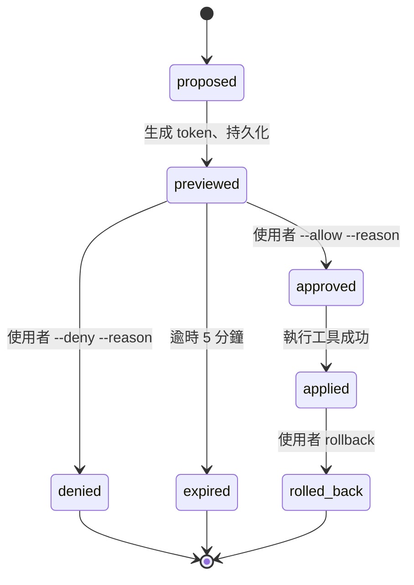

# add-agent-approval 設計文件 / Design Document

## 現況 / Current State

### src/jiezi/agent/grants.py (L17-L23, L48-L63, L65-L78, L93-L112)
- `DENY_NAMES`、`DENY_HOME`、`WINDOWS_DENY`：機密檔案/資料夾模式，任何層級符合即拒絕
- `denied(real: Path) -> str | None`：解析 symlink 後檢查機密位置
- `check(path) -> tuple[Path|None, str|None]`：授權檢查，回傳實際路徑或拒絕理由
- `grant(folder)` / `revoke(folder)`：CLI 專用授權管理，寫入 `var/agent/grants.json`

### src/jiezi/agent/tools.py (L1-L38, L55-L160)
- 四個唯讀工具：`list_dir`、`find_files`、`read_file`、`file_info`
- `SCHEMAS`、`NAMES`：工具定義與名稱集合
- `call(g, name, args, sandbox)`：依名稱派送，參數驗證，回傳結果或 `ToolError`

### src/jiezi/agent/loop.py (L1-L42, L146-L216)
- `MAX_STEPS=6`、`MAX_CALLS_PER_STEP=3`、`RESULT_CHARS=2500` 等上限來自 `limits.EFFECTIVE_LIMITS`
- `McpClient`：stdio 連接工具伺服器子行程，取消時殺 process group
- `run()`：代理迴圈，工具結果視為資料，不遵循內容指示

### src/jiezi/agent/server.py (L1-L62)
- MCP stdio 子集：`initialize`、`ping`、`tools/list`、`tools/call`
- `handle()`：每次呼叫重讀 grant，工具執行後寫入稽核

### src/jiezi/agent/contract.py (L27, L126-L143)
- `RISK_LEVELS = ("low", "medium", "high")`
- `normalize()` 輸出契約含 `risk` 欄位

### src/jiezi/agent/audit.py (L1-L27)
- `write(root, entry)`：每個工具呼叫一行 JSONL，不存檔案內容
- `read(root, days, limit)`：讀取最近 N 天稽核

### src/jiezi/audit.py (L1-L144)
- 相依套件安全稽核（OSV、GitHub advisories），與 agent 稽核分離

### src/jiezi/runtime/gateway.py (L1454-L1465, L2504)
- `GET /v1/agent/audit?days=1`：回傳稽核記錄與授權資料夾
- `_agent` 相關路由在 `lsp_symbols` 可見

---

## 狀態機 / State Machine

```
proposed → previewed → approved/denied/expired → applied → rolled_back
```

| 狀態 | 觸發條件 | 允許轉移 | 說明 |
|------|----------|----------|------|
| `proposed` | 工具伺服器收到高風險工具呼叫 | `previewed` | 初始狀態，產生 token、建立持久化記錄 |
| `previewed` | 使用者查看 preview（CLI/Web） | `approved`、`denied`、`expired` | 使用者可看摘要決定 |
| `approved` | 使用者明確核准 (`--allow --reason`) | `applied` | 執行工具，寫入結果、更新狀態 |
| `denied` | 使用者明確拒絕 (`--deny --reason`) | (終態) | 記錄拒絕理由，不執行工具 |
| `expired` | 逾時未處理（預設 5 分鐘） | (終態) | 自動轉態，token 失效 |
| `applied` | 工具執行成功 | `rolled_back` | 已生效，可發起 rollback |
| `rolled_back` | 使用者執行 rollback | (終態) | 從備份還原，記錄 rollback 時間 |

**Mermaid 圖**：


---

## 核准請求持久化格式 / Approval Request Persistence

**儲存位置**：`var/agent/approvals/YYYY-MM-DD.jsonl`（按天分檔，與稽核一致）

**單行 JSON 結構**：
```json
{
  "id": "apr_20261123_abc123def456",
  "tool": "write_file",
  "arguments": {"path": "/home/user/project/docs/note.md", "content": "內容..."},
  "summary": "在 ~/project/docs/ 建立新檔 note.md (123 字元)",
  "risk": "high",
  "reason": null,
  "status": "previewed",
  "token": "eyJhbGciOiJIUzI1NiIsInR5cCI6IkpXVCJ9...",
  "token_hash": "sha256:abc123...",
  "expires_at": "2026-11-23T14:35:00+08:00",
  "created_at": "2026-11-23T14:30:00+08:00",
  "previewed_at": "2026-11-23T14:30:05+08:00",
  "approved_at": null,
  "denied_at": null,
  "applied_at": null,
  "rolled_back_at": null,
  "backup_path": null,
  "outcome": null,
  "trajectory_id": "traj_xyz789",
  "step": 2,
  "source": "gateway"
}
```

**欄位說明**：

| 欄位 | 型別 | 必填 | 說明 |
|------|------|------|------|
| `id` | string | ✅ | `apr_<timestamp>_<random12>` 唯一識別碼 |
| `tool` | string | ✅ | 工具名稱（目前僅 `write_file`） |
| `arguments` | object | ✅ | 工具參數（不含敏感值完整內容，大檔只存摘要） |
| `summary` | string | ✅ | 人類可讀摘要：路徑、大小、操作類型 |
| `risk` | string | ✅ | `high`（寫入類固定為 high） |
| `reason` | string/null | ❌ | 使用者核准/拒絕時填寫的理由 |
| `status` | enum | ✅ | 狀態機七態之一 |
| `token` | string/null | ❌ | 一次性核准 token（僅 `previewed`/`approved` 時存在，用後即銷） |
| `token_hash` | string | ✅ | `sha256:<hex>`，驗證用，不存明文 token |
| `expires_at` | ISO8601 | ✅ | 逾時時間（建立時 + 5 分鐘） |
| `created_at` | ISO8601 | ✅ | 建立時間 |
| `previewed_at` | ISO8601/null | ❌ | 使用者首次查看 preview 時間 |
| `approved_at` | ISO8601/null | ❌ | 核准時間 |
| `denied_at` | ISO8601/null | ❌ | 拒絕時間 |
| `applied_at` | ISO8601/null | ❌ | 工具執行完成時間 |
| `rolled_back_at` | ISO8601/null | ❌ | Rollback 完成時間 |
| `backup_path` | string/null | ❌ | 備份檔路徑（覆寫/刪除時才有；新檔為 null） |
| `outcome` | string/null | ❌ | `success`/`failed`/`skipped` |
| `trajectory_id` | string | ✅ | 關聯軌跡 ID |
| `step` | int | ✅ | 代理迴圈步數 |
| `source` | string | ✅ | 來源：`gateway`/`cli`/`mcp` |

---

## 一次性核准 Token / One-Time Approval Token

- **格式**：UUID v4（`uuid.uuid4()`），編碼為 URL-safe base64，約 22 字元
- **產生**：`proposed → previewed` 時由伺服器產生
- **驗證**：使用者核准時攜帶 token，伺服器比對 `token_hash`（SHA-256）
- **單次使用**：核准成功後立即清空 `token`、`token_hash`，防重放
- **逾時**：`expires_at` 到期自動失效，狀態轉 `expired`
- **傳輸**：CLI 走參數 `--token`；Web 走 `Authorization: Bearer <token>` header

---

## 逾時機制 / Timeout Mechanism

- **預設逾時**：5 分鐘（300 秒），可由環境變數 `JIEZI_APPROVAL_TIMEOUT_S` 覆寫
- **檢查點**：
  - 工具伺服器每次 `tools/call` 前掃描 `previewed` 狀態且已逾時者，自動轉 `expired`
  - Gateway 定期任務（每分鐘）掃描並清理
- **逾時效果**：token 失效、狀態 `expired`、後續核准請求回傳 410 Gone

---

## Rollback 備份位置與保留期限 / Rollback Backup Location & Retention

| 情況 | 備份策略 | 儲存路徑 | 保留期限 |
|------|----------|----------|----------|
| **新建檔案** (`write_file` 現行) | 無需備份（rollback = 刪除新檔） | N/A | N/A |
| 覆寫既有檔案（未來） | 寫入前 `shutil.copy2(src, backup)` | `var/agent/approvals/backups/<approval_id>_<timestamp>_<filename>` | 7 天（可配置 `JIEZI_APPROVAL_BACKUP_DAYS`） |
| 刪除檔案（未來） | 刪除前移動到備份區 | 同上 | 同上 |
| 刪除資料夾（未來） | 整個資料夾壓縮備份 | 同上 | 同上 |

**清理機制**：Gateway 啟動時與每日 00:00 掃描 `backups/`，刪除超過保留期限的備份。

---

## 稽核欄位擴充 / Audit Field Extensions

**現有 `agent/audit.py` 寫入欄位**：
```python
{"source", "trajectory_id", "step", "tool", "arguments", "allowed", "tool", "path", "entries", "matches", "chars", "kind", "truncated", "suspicious", "size", "type"}
```

**新增欄位**（寫入時機：`tools/call` 完成後）：
| 欄位 | 型別 | 說明 |
|------|------|------|
| `approval_id` | string/null | 關聯的核准請求 ID（高風險工具才有） |
| `token_used` | string/null | 實際使用的 token（僅記錄前 8 字元 + `...`，不存完整） |
| `reason` | string/null | 使用者核准/拒絕理由 |
| `outcome` | enum | `success`、`failed`、`skipped`、`denied`、`expired` |

**範例**：
```json
{
  "at": "2026-11-23T14:32:10+08:00",
  "source": "gateway",
  "trajectory_id": "traj_xyz789",
  "step": 2,
  "tool": "write_file",
  "arguments": {"path": "/home/user/project/docs/note.md"},
  "allowed": true,
  "path": "/home/user/project/docs/note.md",
  "chars": 123,
  "approval_id": "apr_20261123_abc123def456",
  "token_used": "eyJhbGci...",
  "reason": "需要記錄會議筆記",
  "outcome": "success"
}
```

---

## 單一可逆寫入工具：write_file / Single Reversible Write Tool

**工具定義**（加入 `tools.SCHEMAS`）：
```json
{
  "type": "function",
  "function": {
    "name": "write_file",
    "description": "在已授權資料夾內建立新檔案（不可覆寫、不可刪除、不可建立子資料夾）。Create a new file in a granted folder (no overwrite, no delete, no mkdir).",
    "parameters": {
      "type": "object",
      "properties": {
        "path": {"type": "string", "description": "檔案完整路徑，必須在授權資料夾內"},
        "content": {"type": "string", "description": "檔案文字內容，上限 10 MB"}
      },
      "required": ["path", "content"],
      "additionalProperties": false
    }
  }
}
```

**執行邏輯** (`tools.write_file`)：
1. `grants.check_write(path)`：驗證路徑在授權內、非機密、父目錄存在、非 symlink、目標檔不存在
2. 建立核准請求（`proposed`），產生 token，寫入持久化，回傳 `preview` 給模型
3. 模型/使用者透過 CLI/Web 核准（攜帶 token + reason）
4. 伺服器驗證 token、狀態為 `previewed`、未逾時
5. 原子寫入：`os.open(path, O_WRONLY|O_CREAT|O_EXCL, 0o644)` → 寫入內容 → `fsync`
6. 更新狀態 `applied`，寫入稽核（含 `approval_id`、`reason`、`outcome: success`）
7. 回傳結果給模型

**拒絕情況**：
- 路徑不在授權資料夾 → `refused: outside granted folders`
- 目標檔已存在 → `refused: file already exists (no overwrite)`
- 父目錄不存在 → `refused: parent directory does not exist`
- 路徑為 symlink 或指向 symlink → `refused: symlink not allowed`
- 內容超過 10 MB → `refused: content too large`
- 磁碟空間不足（< 100 MB）→ `refused: insufficient disk space`

---

## CLI 介面 / CLI Interface

**新增子命令**：`scripts/jiezi agent approve`

```bash
# 列出待核准請求
jiezi agent approve list [--days 1]

# 核准單一請求
jiezi agent approve allow <approval_id> --reason "理由" --token <token>

# 拒絕單一請求
jiezi agent approve deny <approval_id> --reason "理由"

# Rollback 已執行的請求
jiezi agent approve rollback <approval_id> --reason "理由"

# 查看詳情（含 preview 內容）
jiezi agent approve show <approval_id>
```

**回傳格式**：JSON，供腳本與人類閱讀。

---

## Gateway 端點 / Gateway Endpoints

| 端點 | 方法 | 用途 | 權限 |
|------|------|------|------|
| `/v1/agent/approvals` | GET | 列出待核准/最近記錄 | Bearer token |
| `/v1/agent/approvals/{id}` | GET | 取得單一請求詳情（含 preview 內容） | Bearer token |
| `/v1/agent/approvals/{id}` | POST | 核准/拒絕/rollback | Bearer token + JSON body |

**POST body**：
```json
{
  "action": "allow|deny|rollback",
  "reason": "使用者理由",
  "token": "一次性 token（allow/rollback 需要）"
}
```

---

## Open Questions 回填建議 / Open Questions Recommendations

| # | 建議值 | 理由 |
|---|--------|------|
| Q1 | CLI + 桌面網頁端點 | CLI 為主力操作介面；網頁端點預留 Desktop App 整合 |
| Q2 | 可配置，預設 5 分鐘 | 平衡人類反應時間與安全性；環境變數覆寫支援測試 |
| Q3 | 可配置，預設 7 天 | 足夠發現問題；不佔過多磁碟；環境變數覆寫 |
| Q4 | 10 MB | 一般文字/程式碼足夠；避免大檔攻擊 |
| Q5 | 是（完整內容；主控更正，原為前 200 字） | 讓使用者確認內容無誤再核准 |
| Q6 | 父目錄必須存在 | 避免目錄遍佈；符合最小權限原則 |
| Q7 | 明文 JSONL | 本機檔案受 OS 權限保護；token 只存 hash；敏感值不入稽核 |

---

## 風險緩解 / Risk Mitigations

| 風險 | 緩解措施 |
|------|----------|
| TOCTOU（檢查與寫入間隙） | `os.open(O_EXCL|O_CREAT)` 原子建立；不跟隨 symlink |
| Token 洩漏 | 僅存 hash；用後即銷；5 分鐘逾時；HTTPS 傳輸 |
| 提示注入誘導核准 | Preview 顯示完整內容（主控更正：原為只顯示前 200 字，會讓注入內容藏在後段）；不含完整工具結果；injection guard 持續運作 |
| 磁碟寫滿 | 寫入前檢查可用空間 > 100 MB；單檔 10 MB 上限 |
| 權限繞過 | 每次呼叫重讀 grant；核准不改變 grant；model 無法修改核准狀態 |
| 宕機中斷 | 狀態機持久化；重啟後可從 `previewed`/`approved` 繼續或清理 |

---

## 相容性與遷移 / Compatibility & Migration

- **現有唯讀工具零影響**：`list_dir`/`find_files`/`read_file`/`file_info` 行為不變
- **Grant 機制不變**：`write_file` 同樣受 `grants.check_write` 控制
- **稽核格式相容**：新欄位為 optional，舊記錄讀取不受影響
- **Contract 風險等級**：高風險工具固定 `risk: "high"`，契約驗證不阻擋工具註冊
- **無資料庫遷移**：純 JSONL 檔案，新舊共存