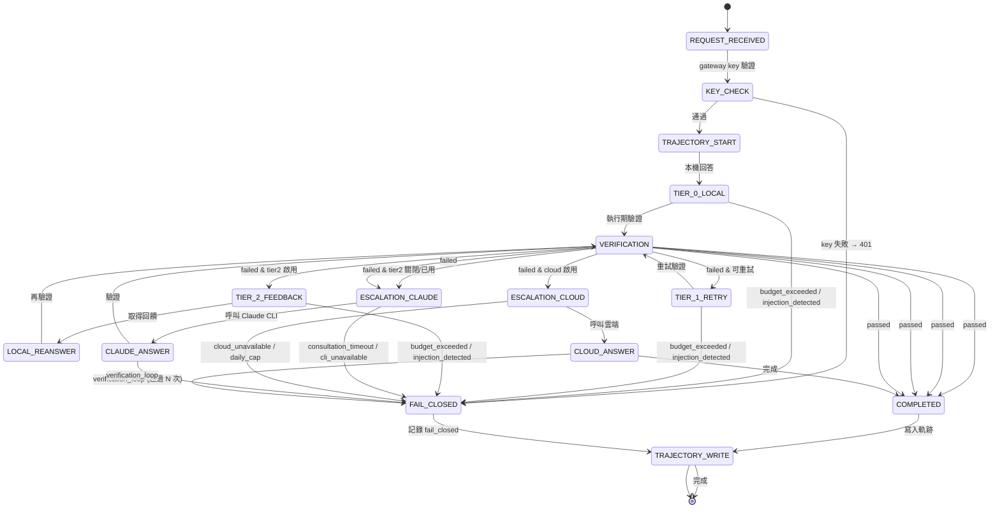

# add-agent-observability 設計文件 / Design Document

## 1. 統一欄位表 / Unified Field Table

| 統一欄位 / Unified Field | 型別 / Type | 來源模組 / Source Module | 敏感？ / Sensitive? | 遮罩規則 / Masking Rule | 備註 / Notes |
|------------------------|------------|-------------------------|-------------------|------------------------|-------------|
| **request_id** | `str` (UUIDv4) | `trajectory`, `gateway` | 否 | — | 跨模組關聯鍵 |
| **timestamp** | `str` (ISO 8601 UTC) | `trajectory.at`, `audit.at`, `loop.started_at` | 否 | — | 統一 ISO 格式 |
| **policy** | `str` (`jiezi`/`jiezi-local`/`jiezi-cloud`/`jiezi-ask-claude`) | `trajectory.policy`, `gateway` 選擇 | 否 | — | |
| **terminal_state** | `str` (`completed`/`failed`/`aborted`/`fail_closed`) | `trajectory.status`→映射, `loop.terminal_state` | 否 | — | **統一值域**，取代 `ok`/`agent_error`/`cancelled` |
| **tier** | `int` (0–3) | `trajectory.final_tier`, `gateway jiezi.tier` | 否 | — | |
| **provider** | `str` (`local`/`claude`/`cloud`) | `trajectory.tiers[*].provider` | 否 | — | 取代中文標籤 |
| **verification** | `object` `{status: "passed"|"failed"|"not_applicable", details?: str}` | `trajectory.tiers[*].verification`, `process.check` | 否 | — | 統一結構 |
| **escalation_reason** | `str` (`none`/`verification_failed`/`daily_cap_reached`/`self_reported_unsure`/`consult_failed`/`needs_web`/`local_unavailable`) | `trajectory.jiezi.escalation`, `stats.reasons` key 解析 | 否 | — | **標準化原因碼**，取代複合鍵 |
| **model_actual** | `str` | `trajectory.tiers[*].model`, `gateway jiezi.model` | 否 | — | 實際使用模型 |
| **latency_s** | `float` | `trajectory.tiers[*].latency_s`, `gateway jiezi.latency_s` | 否 | — | 秒 |
| **tokens_input** | `int` | `trajectory.tiers[*].tokens.input`, `gateway jiezi.cloud.tokens.input` | 否 | — | |
| **tokens_output** | `int` | `trajectory.tiers[*].tokens.output`, `gateway jiezi.cloud.tokens.output` | 否 | — | |
| **cost_usd** | `float` | `trajectory.tiers[*].cost`, `gateway jiezi.cloud.cost` | 否 | — | |
| **tps** | `float` | `trajectory.tiers[*].tps`, `dashboard.tps` | 否 | — | tokens/秒 |
| **tool_filter** | `object` `{original: int, kept: int, dropped: int, stage: str, names: str[]}` | `trajectory.rec.tool_filter`, `tool_filter.select()` 回傳 | 否 | — | **完整記錄**，含 `dropped` 計數 |
| **effective_tools** | `str[]` | `trajectory.rec.tool_filter.names`, `loop.effective_tools`, `contract.effective_tools` | 否 | — | 實際可用工具名單 |
| **budget_requested** | `object` `{max_steps?: int, max_calls_per_step?: int, result_chars?: int, old_result_chars?: int, tools_budget?: int, call_timeout_s?: int}` | `contract.budget.requested` | 否 | — | 契約原始預算 |
| **budget_effective** | `object` (同結構) | `contract.budget.effective`, `loop.effective_budget`, `limits.EFFECTIVE_LIMITS` | 否 | — | **單一來源**，受 `EFFECTIVE_LIMITS` 上限約束 |
| **facts_budgets_cpu_threads** | `int` | `facts.budgets.cpu.usable_threads` | 否 | — | 僅供參考，不直接限制 agent |
| **facts_budgets_vram_mib** | `int` | `facts.budgets.vram.total_mib` | 否 | — | 僅供參考 |
| **training_use** | `bool|null` (`true`/`false`/`null`) | `trajectory.training_use`, `loop.suspected` 反推 | 否 | — | `false`=不可訓練（Claude 諮詢），`null`=待授權表判斷 |
| **injection_suspected** | `bool` | `trajectory.rec.injection.suspected`, `loop.suspected` | 否 | — | 提示注入疑似 |
| **contract_goal** | `str` | `trajectory.rec.agent.contract.goal`, `contract.goal` | 否 | `_scrub_text()` | 經遮罩 |
| **contract_done_criteria** | `str` | `trajectory.rec.agent.contract.done_criteria`, `contract.done_criteria` | 否 | `_scrub_text()` | 經遮罩 |
| **contract_risk** | `str` (`low`/`medium`/`high`) | `contract.risk` | 否 | — | |
| **fail_closed** | `bool` | 新增：`trajectory.status=="fail_closed"`、`loop.terminal_state=="fail_closed"`、`gateway jiezi.fail_closed` | 否 | — | **核心新增**，三層同步 |
| **fail_closed_reason** | `str` | 新增：觸發 `fail_closed` 的具體原因 | 否 | — | 如 `budget_exceeded`、`injection_detected`、`verification_loop` |

---

## 2. 遮罩規則 / Masking Rules

| 規則名 / Rule | 適用欄位 / Applies To | 實作 / Implementation |
|-------------|----------------------|----------------------|
| `_scrub_text()` | `contract_goal`, `contract_done_criteria`, `tool_call.arguments` 字串值 | 移除 `sk-`/`ghp_`/`gho_`/`glpat-` 等前綴的 token；遮蓋類金鑰模式；保留結構 |
| `_scrub_tool_result()` | `trajectory.tiers[*].answer` (tool call 結果)、`audit.entry.result_summary` | 不記檔案內容；只記工具名、成功/失敗、結果長度、錯誤類別 |
| `_scrub_messages()` | `trajectory.request_messages` | 不記 system prompt 完整內容；user/assistant 訊息僅保留前 200 字、含金鑰模式則遮蓋 |
| `no_secrets_in_var()` | 所有寫入 `var/` 的 JSONL | 寫入前統一呼叫 `_scrub_all(record)`；紅隊測試驗證無洩漏 |

**集中化遮罩函數位置**：`src/jiezi/observability/masking.py`（新模組）

---

## 3. 狀態機 / State Machine

**關鍵規則**：
- `fail_closed` 可在**任何階段**觸發，一旦觸發不再嘗試後續層級
- `fail_closed_reason` 必填，寫入 trajectory 與 gateway 回應 `jiezi.fail_closed_reason`
- `/health` 暴露 `fail_closed_count_24h`、`last_fail_closed_reason`

---

## 4. 預算對齊規則 / Budget Alignment Rules

| Agent Budget (EFFECTIVE_LIMITS) | Facts Budget | 對齊關係 / Alignment |
|--------------------------------|-------------|---------------------|
| `max_steps=6` | — | 固定上限，不隨 facts 變動 |
| `max_calls_per_step=3` | — | 固定上限 |
| `result_chars=2500` | `vram.total_mib` | **參考關係**：VRAM < 4GB 時建議降至 1500，但**不強制**；規格註明獨立 |
| `old_result_chars=400` | — | 固定 |
| `tools_budget=2600` (token) | `vram.total_mib` | **參考關係**：VRAM < 4GB 時建議降至 1500，但**不強制** |
| `call_timeout_s=120` | `cpu.usable_threads` | **參考關係**：threads ≥ 16 時可降至 60s，但**不強制** |

**結論**：`task budget` 與 `facts budgets` **各自獨立**，`observability` spec 僅記錄「參考建議」，不實作強制綁定。未來若需動態調整，擴充 `observability.budget_policy` 介面。

---

## 5. 模組對應變更 / Module Change Mapping

| 檔案 / File | 變更類型 / Change | 具體動作 / Actions |
|------------|------------------|-------------------|
| `src/jiezi/observability/__init__.py` | NEW | 匯出統一常數、遮罩函數、狀態機 |
| `src/jiezi/observability/fields.py` | NEW | `UNIFIED_FIELDS` 定義、型別註解、預設值 |
| `src/jiezi/observability/masking.py` | NEW | `_scrub_text()`, `_scrub_tool_result()`, `_scrub_messages()`, `_scrub_all()` |
| `src/jiezi/observability/state.py` | NEW | `TerminalState` enum、`FailClosedReason` enum、狀態轉移驗證 |
| `src/jiezi/runtime/trajectory.py` | MODIFY | 寫入欄位對齊統一表；`tool_filter` 含 `dropped`；新增 `fail_closed`/`fail_closed_reason` |
| `src/jiezi/agent/audit.py` | MODIFY | entry 欄位對齊；呼叫 `_scrub_all()`；`terminal_state` 統一值域 |
| `src/jiezi/agent/loop.py` | MODIFY | `info` 欄位對齊；`effective_budget` 從 `limits.EFFECTIVE_LIMITS` 衍生；新增 `fail_closed` 觸發邏輯 |
| `src/jiezi/agent/contract.py` | MODIFY | `budget.effective` 受 `EFFECTIVE_LIMITS` cap；回傳對齊統一欄位名 |
| `src/jiezi/agent/limits.py` | MODIFY | **唯一來源**確認；新增 `to_budget_dict()` 供 `contract`/`loop` 使用 |
| `src/jiezi/runtime/gateway.py` | MODIFY | 回應 `jiezi` 欄位對齊；`_filter_tools()` 回傳完整 `tool_filter` 含 `dropped` |
| `src/jiezi/runtime/tool_filter.py` | MODIFY | `select()` 回傳含 `dropped`；`ladder()` 對齊 |
| `src/jiezi/runtime/process.py` | MODIFY | `steps()` 輸出對齊統一欄位；新增 `fail_closed` 步驟 |
| `src/jiezi/runtime/dashboard.py` | MODIFY | 指標計算來源對齊；輸出含 `fail_closed` 統計 |
| `src/jiezi/runtime/stats.py` | MODIFY | `escalation_reason` 標準化；輸出對齊 |
| `tests/test_observability_*.py` | NEW | 統一欄位測試、遮罩測試、狀態機測試、紅隊測試 |
| `scripts/jiezi_dashboard.py` | MODIFY | 讀取新欄位、顯示 `fail_closed` |

---

## 6. 規格 Delta / Spec Delta Overview

### ADDED: `observability/spec.md`
- 統一欄位表（含型別、敏感標記、遮罩規則）
- 遮罩規範
- 狀態機定義（含 `fail_closed`）
- 預算對齊規則（參考關係、不強制綁定）

### MODIFIED: `trajectory/spec.md`
- `status` 值域變更：`ok`/`agent_error`/`cancelled` → `completed`/`failed`/`aborted`/`fail_closed`
- 新增 `fail_closed`、`fail_closed_reason`、`tool_filter.dropped`
- `training_use` 語意澄清
- `tool_filter` 結構標準化

### MODIFIED: `audit/spec.md`
- Agent audit entry 欄位對齊 trajectory
- 明確遮罩要求

### MODIFIED: `agent/spec.md`
- `terminal_state` 值域與 trajectory 一致
- `effective_budget` 來源單一化
- `fail_closed` 觸發條件

### MODIFIED: `gateway/spec.md`
- 回應 `jiezi` 欄位對齊統一表
- `tool_filter` 完整記錄
- 新增 `jiezi.fail_closed`、`jiezi.fail_closed_reason`

### MODIFIED: `escalation/spec.md`
- `escalation_reason` 標準化值域
- 與 `stats.reasons` 對齊

### ADDED: `dashboard/spec.md`
- 儀表板讀取介面（查詢參數、回傳格式）
- 指標定義（成就率、本地處理率、速度、fail_closed 率）
- 匯出格式（JSON/CSV）

### ADDED: `process/spec.md`
- 既有 `process.py` 對外介面規格
- `steps()` 輸出結構
- 前端穩定介面承諾

---

## 7. 驗證矩陣 / Verification Matrix

| 驗證項目 / Check | 方法 / Method | 通過條件 / Pass Criteria |
|----------------|-------------|------------------------|
| 統一欄位一致性 | 讀取 trajectory/audit/loop/contract/gateway/process/dashboard/stats 7 模組輸出，比對同名欄位型別/值域 | 100% 一致 |
| 敏感內容零洩漏 | 紅隊測試：注入金鑰、.env 內容、檔案路徑、私鑰模式 | 所有寫入 `var/` 檔案經 `_scrub_all()`，無明文敏感資訊 |
| Fail-closed 觸發 | 單元測試覆蓋 7 種觸發路徑；整合測試模擬 budget exceeded、injection、verification loop | 每種觸發都正確寫入 `fail_closed=true`、`fail_closed_reason` |
| 預算單一來源 | 測試比較 `limits.EFFECTIVE_LIMITS`、`contract.budget.effective`、`loop.effective_budget` 六鍵值 | 完全相同 |
| Tool filter 完整性 | 測試 `tool_filter.select()` 回傳含 `original/kept/dropped/stage/names`，`dropped = original - kept` | 算式成立、階段正確 |
| 狀態機合法轉移 | 屬性測試：隨機生成序列，驗證不進入非法狀態 | 0 非法轉移 |
| 規格驗證 | `openspec validate add-agent-observability --strict` + `--all --strict` | 雙通過 |
| 格式檢查 | `git diff --check` | 乾淨輸出 |
| 全量測試 | `PYTHONPATH=src:tests .venv/bin/python -m unittest discover -s tests` | ≥ 759 通過、0 失敗、0 新增錯誤 |

---

## 8. 實作優先序 / Implementation Priority

| 階段 / Phase | 工作項 / Tasks | 產出 / Deliverable |
|------------|--------------|------------------|
| **P0** | 建立 `observability/` 模組、統一常數、遮罩函數、狀態機 | `src/jiezi/observability/` 可被 import |
| **P1** | 修改 `limits.py` 確保單一來源、提供 `to_budget_dict()` | `EFFECTIVE_LIMITS` 不可變、衍生方便 |
| **P2** | 修改 `trajectory.py`、`agent/audit.py` 寫入端對齊 | 軌跡/稽核檔案含新欄位、值域正確 |
| **P3** | 修改 `loop.py`、`contract.py`、`tool_filter.py` 核心邏輯對齊 | agent 迴圈、契約、工具篩選一致 |
| **P4** | 修改 `gateway.py` 回應對齊、新增 `fail_closed` | API 回應符合統一表 |
| **P5** | 修改 `process.py`、`dashboard.py`、`stats.py` 讀取端對齊 | 儀表板、統計、處理視圖正確 |
| **P6** | 撰寫規格 delta、單元測試、紅隊測試 | specs、tests 通過 |
| **P7** | 全量測試、規格驗證、文檔同步 | 綠燈、WORKER_REPORT.md |